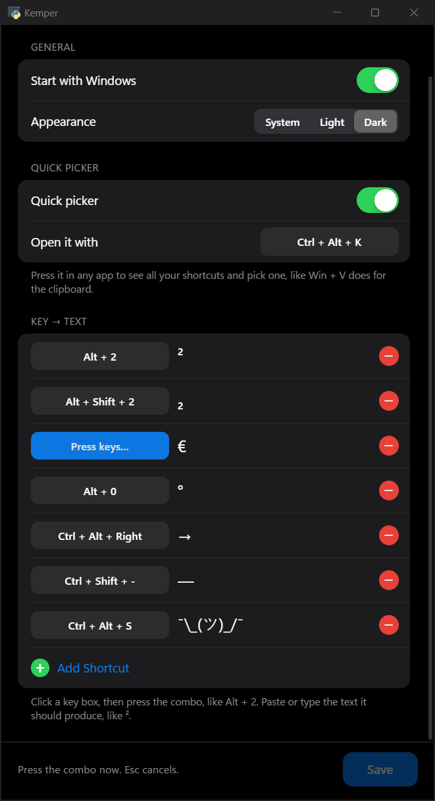
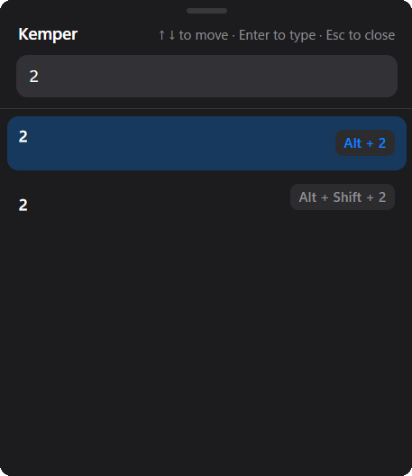

# Kemper

**Kemper** (short for **Key Mapper**) types a character or a piece of text when you press a key combo, in any app on Windows.

Press **Alt + 2** and get **²**. Press **Alt + Shift + 2** and get **₂**. Press **Ctrl + Alt + E** and get **€**. You choose the combos and the text. Can't remember them all? Press **Ctrl + Alt + K** to pick from a list, like **Win + V** does for the clipboard.

<p align="center">
  
  
</p>

[](https://github.com/Shashwat-Gupta57/Kemper/actions/workflows/tests.yml)


[](LICENSE)

## Features

- **Works in every app.** Word, Chrome, Discord, VS Code, Notepad, anything you can type into.
- **Set a combo like in a game.** Click the key box, press the keys, and you're done.
- **Any text.** One character, an emoji, a symbol, or a whole phrase.
- **Quick picker.** One combo pops up all your shortcuts by the mouse. Search, pick, and Kemper types it.
- **Catches clashes.** If two shortcuts use the same keys, both turn red and Kemper won't save until you fix them.
- **Light and dark mode.** Follows Windows, or pick one yourself.
- **Starts with Windows** if you want, and runs quietly in the background. Closing the window doesn't stop it.
- **Deactivate** turns every shortcut off without quitting.
- **Full command line.** Run it with no window, and add, remove, list and check shortcuts from a terminal.
- **One file.** The whole program is [`kemper.pyw`](kemper.pyw).

## Get started

You need **Windows 10 or 11** and **[Python 3.10 or newer](https://www.python.org/downloads/)**.

1. Download [`kemper.pyw`](kemper.pyw) and put it in a folder where it can stay, for example `C:\Tools\Kemper\`.
2. Install the one library the window uses:

   ```powershell
   python -m pip install pywebview
   ```

3. Double-click `kemper.pyw`. The window opens.
4. Turn on **Start with Windows** in the window if you want Kemper running every time you sign in.

Only using the command line? You can skip pywebview. See [From the command line](#from-the-command-line).

## Use it

### Add a shortcut

1. Click **Add Shortcut**. The key box turns blue and says *Press keys…*
2. Press your combo, for example **Alt + 2**. Esc cancels.
3. Type or paste the text it should produce, for example `²`.
4. Click **Save** (or press **Ctrl + S**).

Now press Alt + 2 in any app and ² appears.

| Recording a combo | Two shortcuts with the same keys |
|---|---|
|  |  |

### Quick picker

Press **Ctrl + Alt + K** in any app. A small panel opens by your mouse with every shortcut you've made.
- **Type** to search, **↑ ↓** to move, and **Enter** or a click to type the selected one into the app you were in.
- **Esc**, clicking elsewhere, or the same combo again closes it.
- **Drag it by the top strip** to move it out of the way.

<p align="center">
  
  
</p>

Change its combo, or turn it off, in the **Quick Picker** section of the window.

### Running in the background

Closing the window only hides it; your shortcuts keep working. Open `kemper.pyw` again to bring the window back.
- **Quit** stops Kemper.
- **Deactivate** turns all shortcuts off but leaves Kemper running.


### From the command line

Everything the window does also works from a terminal. Changes reach a running Kemper right away.

```console
> python kemper.pyw --add "Alt+2" "²"
Added Alt + 2  →  ²

> python kemper.pyw --add "Alt+Shift+2" "₂"
Added Alt + Shift + 2  →  ₂

> python kemper.pyw --keys
  Alt + 2          →  ²
  Alt + Shift + 2  →  ₂

2 shortcut(s), active. Quick picker: Ctrl + Alt + K

> python kemper.pyw --add "alt+2" "x"
kemper: Alt + 2 already types ². Remove it first:  python kemper.pyw --remove "alt+2"

> python kemper.pyw --autostart on
Kemper will start when you sign in to Windows.
```

Run Kemper with no window at all. Every shortcut you use is logged as it happens:

```console
> python kemper.pyw --cli
Kemper 1.0.0 is running in this terminal (no window).
  2 shortcut(s) active. Each one shows up here when you use it.
  Press Ctrl+C to stop.

  13:19:58  Alt + 2  →  ²
  13:20:04  Alt + Shift + 2  →  ₂
```

Something not working? `--doctor` checks everything and tells you how to fix each problem:

```console
> python kemper.pyw --doctor
Kemper 1.0.0 doctor

  ✓  Python 3.12.10
  ✓  pywebview 6.2.1 is installed (needed for the window)
  ✓  Edge WebView2 158.0.4370.33 (draws the window)
  ✓  2 shortcut(s) saved in C:\Users\you\AppData\Roaming\Kemper\mappings.json
  ✓  Shortcuts are active
  ✓  Kemper is running
  ✓  Starts with Windows
  ✓  Skipped the hotkey check because the running Kemper is holding them

All good.
```

All commands:

| Command | What it does |
|---|---|
| *(none)* | Open the window |
| `--cli` | Run in the terminal with no window. Ctrl+C stops it |
| `--keys` | List your shortcuts |
| `--add COMBO TEXT` | Add a shortcut |
| `--remove COMBO` | Remove a shortcut |
| `--picker COMBO` / `on` / `off` | Set the quick picker's combo, or turn it on or off |
| `--activate` / `--deactivate` | Turn all shortcuts on or off |
| `--autostart on` / `off` | Start Kemper when you sign in to Windows, or stop doing so |
| `--status` | Is Kemper running? Where are its files? |
| `--doctor` | Find problems and say how to fix them |
| `--show` | Open the window of the running Kemper |
| `--quit` | Stop the running Kemper |
| `--uninstall` | Remove Kemper from this PC |
| `--help`, `--version` | Help, version |

## Ideas for shortcuts

| Combo | Types | Handy for |
|---|---|---|
| Alt + 2 / Alt + Shift + 2 | ² / ₂ | Math, chemistry (H₂O, x²) |
| Alt + 0 | ° | Temperatures, angles |
| Ctrl + Alt + E | € | Prices |
| Ctrl + Alt + Right | → | Notes, arrows |
| Ctrl + Shift + - | — | Em dash in writing |
| Ctrl + Alt + S | `¯\_(ツ)_/¯` | Chat |

## Uninstall

```powershell
python kemper.pyw --uninstall
```

This asks you to confirm, then stops Kemper, removes it from Windows startup, deletes your shortcuts and settings, and deletes `kemper.pyw` itself. It changes nothing else on your PC. Add `--yes` to skip the question.

## Documentation

The [full documentation](docs/DOCUMENTATION.md) covers every command, the combo syntax, the quick picker, the settings file, how Kemper works inside, troubleshooting and limits.

## Contributing

Bug reports and pull requests are welcome. See [CONTRIBUTING.md](CONTRIBUTING.md).

## License

[MIT](LICENSE) © 2026 Shashwat Gupta
