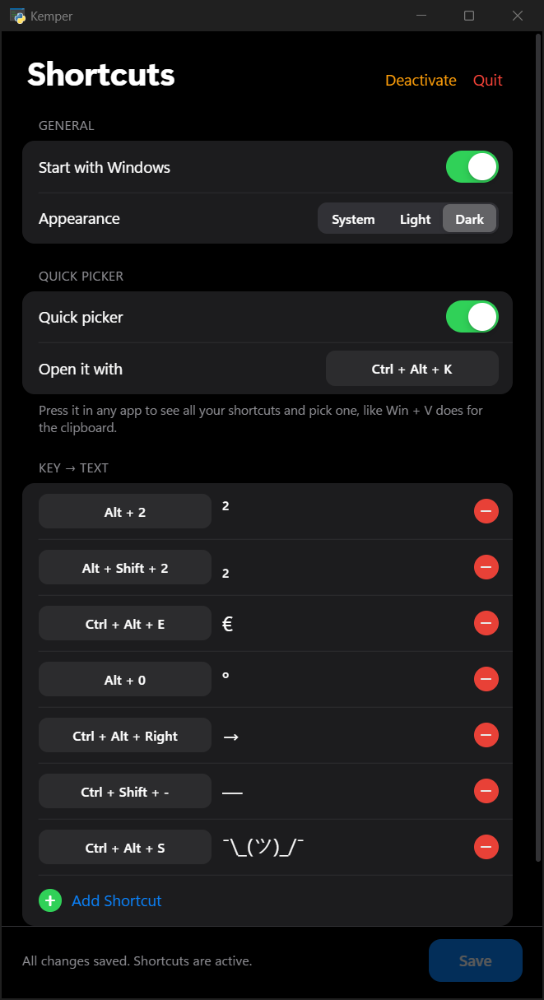
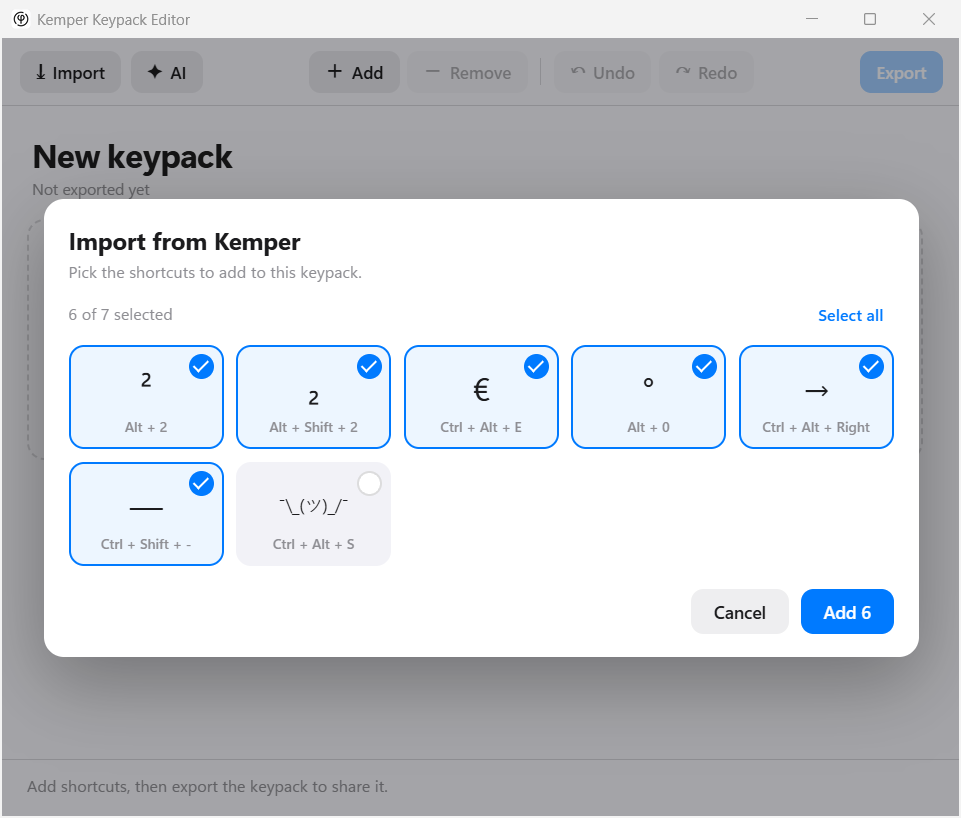
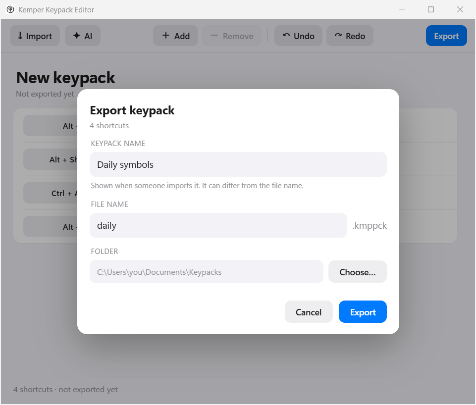
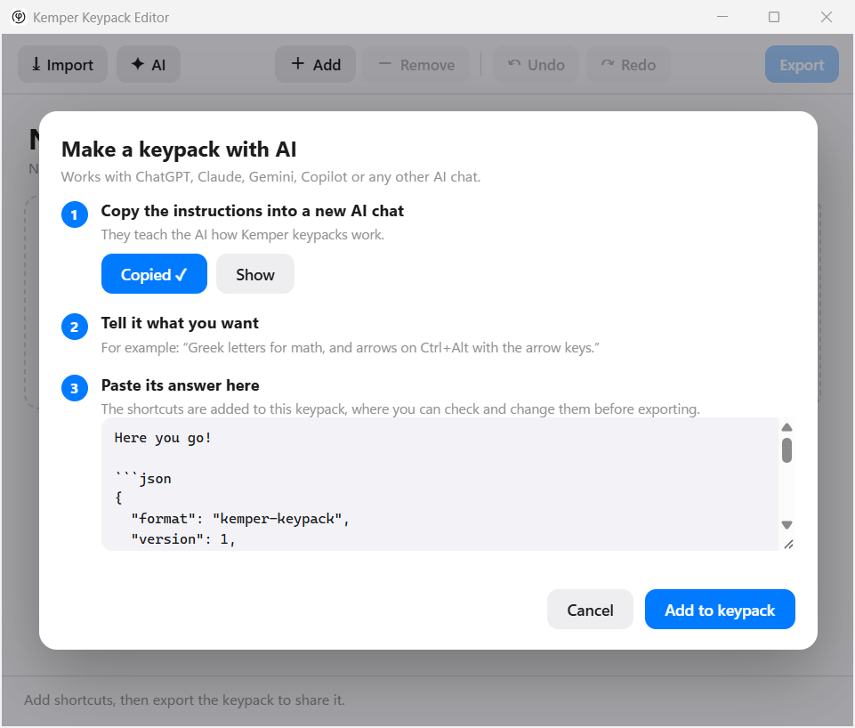
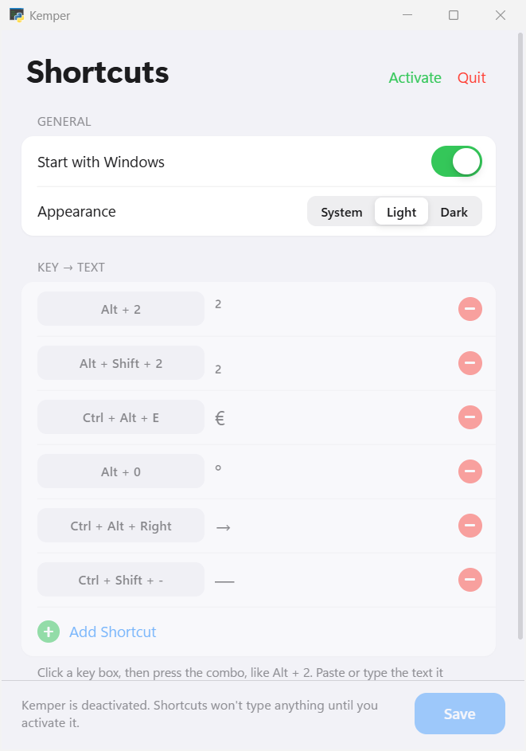

<p align="center"></p>

<h1 align="center">Kemper</h1>

<p align="center"><a href="https://kemper.talken.in"><b>kemper.talken.in</b></a> · <a href="https://github.com/Shashwat-Gupta57/Kemper/releases/latest/download/kemper.pyw">Download</a> · <a href="docs/DOCUMENTATION.md">Documentation</a></p>

**Kemper** (short for **Key Mapper**) types a character or a piece of text when you press a key combo, in any app on Windows, macOS or Linux.

Press **Alt + 2** and get **²**. Press **Alt + Shift + 2** and get **₂**. Press **Ctrl + Alt + E** and get **€**. You choose the combos and the text. Can't remember them all? Press **Ctrl + Alt + K** to pick from a list, like **Win + V** does for the clipboard.

<p align="center">
  
  
</p>

[](https://github.com/Shashwat-Gupta57/Kemper/actions/workflows/tests.yml)


[](LICENSE)

## Features

- **Works in every app.** Word, Chrome, Discord, VS Code, Notepad, anything you can type into.
- **Set a combo like in a game.** Click the key box, press the keys, and you're done.
- **Any text.** One character, an emoji, a symbol, or a whole phrase.
- **Quick picker.** One combo pops up all your shortcuts by the mouse. Search, pick, and Kemper types it.
- **Keypacks.** Share sets of shortcuts as `.kmppck` files. Double-click one to preview it and import it.
- **Made by AI.** Describe the shortcuts you want to any AI chat, paste its answer into Kemper, done.
- **Catches clashes.** If two shortcuts use the same keys, both turn red and Kemper won't save until you fix them.
- **Light and dark mode.** Follows your system, or pick one yourself.
- **Starts when you sign in** if you want, and runs quietly in the background. Closing the window doesn't stop it.
- **Desktop shortcut** with Kemper's own icon, one switch away (Windows and Linux).
- **Windows, macOS and Linux.** Your settings and keypacks work on all three.
- **Deactivate** turns every shortcut off without quitting.
- **Full command line.** Run it with no window, and add, remove, list and check shortcuts from a terminal.
- **One file.** The whole program is [`kemper.pyw`](kemper.pyw).

## Get started

Download [`kemper.pyw`](https://github.com/Shashwat-Gupta57/Kemper/releases/latest/download/kemper.pyw) and put it in a folder where it can stay. You need [Python 3.10 or newer](https://www.python.org/downloads/).

### Windows 10 and 11

```powershell
python -m pip install pywebview
```

Double-click `kemper.pyw`. In the window, turn on **Start with Windows** and **Desktop shortcut** if you want them. Windows always shows a `.pyw` file with Python's icon, so the desktop shortcut is what carries Kemper's icon.

### macOS

```bash
python3 -m venv ~/.kemper
~/.kemper/bin/pip install pywebview pynput
~/.kemper/bin/python kemper.pyw
```

The first time, macOS asks to let Terminal (or Python) **monitor input** and use **Accessibility**. Allow both in System Settings → Privacy & Security, then start Kemper again. Kemper can't see or type keys without them. Turn on **Start at login** in the window if you want it.

### Ubuntu and other Linux

```bash
sudo apt install python3-venv python3-gi gir1.2-webkit2-4.1 xclip
python3 -m venv --system-site-packages ~/.kemper
~/.kemper/bin/pip install pywebview python-xlib
~/.kemper/bin/python kemper.pyw
```

Kemper needs an **X11 session**. On Ubuntu's login screen, click the gear and pick **"Ubuntu on Xorg"**. Wayland, the default, doesn't let any app have global hotkeys. Turn on **Start at login** and **Desktop shortcut** in the window if you want them; double-clicking `.kmppck` keypacks works too.

`python3 kemper.pyw --doctor` checks your setup on any system and tells you what's missing. Only using the command line? You can skip pywebview. See [From the command line](#from-the-command-line).

## Use it

### Add a shortcut

1. Click **Add Shortcut**. The key box turns blue and says *Press keys…*
2. Press your combo, for example **Alt + 2**. Esc cancels.
3. Type or paste the text it should produce, for example `²`.
4. Click **Save** (or press **Ctrl + S**).

Now press Alt + 2 in any app and ² appears.

| Recording a combo | Two shortcuts with the same keys |
|---|---|
|  |  |

### Quick picker

Press **Ctrl + Alt + K** in any app. A small panel opens by your mouse with every shortcut you've made.
- **Type** to search, **↑ ↓** to move, and **Enter** or a click to type the selected one into the app you were in.
- **Esc**, clicking elsewhere, or the same combo again closes it.
- **Drag it by the top strip** to move it out of the way.

<p align="center">
  
  
</p>

Change its combo, or turn it off, in the **Quick Picker** section of the window.

### Keypacks

A keypack is a set of shortcuts in one `.kmppck` file, ready to share: Greek letters, math symbols, your team's phrases.

**Importing.** Double-click a `.kmppck` file. Kemper opens and shows everything in it before you decide:
- **Red:** clashes with your own shortcuts, or with itself.
- **Orange:** shortcuts that would take over keys you use a lot, like Ctrl + C.
- **Gray:** shortcuts you already have, which are skipped.

You can import even with conflicts. The red ones land in your list, and Kemper won't save until you change them. You can also pick a file with **Keypacks → Import a keypack…** in the window.


**Making one.** Click **Keypacks → Create a keypack** at the bottom of the window, then **New keypack** (or **Edit a keypack file…**). The Keypack Editor opens:
- **Import** (top left) shows your Kemper shortcuts as a gallery. Pick some, or **Select all**, then deselect any you don't want.
- **Add** makes a new shortcut, and **Remove** deletes the selected one.
- **Undo** and **Redo** go back and forth through your last 50 changes (Ctrl + Z, Ctrl + Y).
- **Export** asks for the keypack's name, a file name and a folder. The name is stored inside the file, so the two can differ.

| Picking shortcuts from Kemper | Exporting |
|---|---|
|  |  |

### Make keypacks with AI

Let ChatGPT, Claude, Gemini or any other AI chat write the keypack:

1. In the Keypack Editor, click **✦ AI**, then **Copy instructions**. Or use **Create a keypack → Make one with AI…**, or copy them from [docs/AI_INSTRUCTIONS.md](docs/AI_INSTRUCTIONS.md).
2. Paste them into a new AI chat and say what you want: *"Greek letters for math, capitals on Shift"*, *"my email signature on Ctrl+Alt+S"*, *"arrows on Ctrl+Alt + arrow keys"*.
3. Paste the AI's whole answer into step 3 and click **Add to keypack**.

The shortcuts appear in the editor. Check them, then export the keypack or import it into your Kemper. Kemper validates everything the AI wrote and marks any clashes.



Keypacks are plain JSON, so you can also write one by hand:

```json
{
  "format": "kemper-keypack",
  "version": 1,
  "name": "Arrows",
  "mappings": [
    { "keys": "Ctrl+Alt+Left", "text": "←" },
    { "keys": "Ctrl+Alt+Right", "text": "→" }
  ]
}
```

### Running in the background

Closing the window only hides it; your shortcuts keep working. Open `kemper.pyw` again to bring the window back.
- **Quit** stops Kemper.
- **Deactivate** turns all shortcuts off but leaves Kemper running.



### From the command line

Everything the window does also works from a terminal. Changes reach a running Kemper right away.

```console
> python kemper.pyw --add "Alt+2" "²"
Added Alt + 2  →  ²

> python kemper.pyw --add "Alt+Shift+2" "₂"
Added Alt + Shift + 2  →  ₂

> python kemper.pyw --keys
  Alt + 2          →  ²
  Alt + Shift + 2  →  ₂

2 shortcut(s), active. Quick picker: Ctrl + Alt + K

> python kemper.pyw --add "alt+2" "x"
kemper: Alt + 2 already types ². Remove it first:  python kemper.pyw --remove "alt+2"

> python kemper.pyw --autostart on
Kemper will start when you sign in.
```

Run Kemper with no window at all. Every shortcut you use is logged as it happens:

```console
> python kemper.pyw --cli
Kemper 3.0.0 is running in this terminal (no window).
  2 shortcut(s) active. Each one shows up here when you use it.
  Press Ctrl+C to stop.

  13:19:58  Alt + 2  →  ²
  13:20:04  Alt + Shift + 2  →  ₂
```

Something not working? `--doctor` checks everything and tells you how to fix each problem:

```console
> python kemper.pyw --doctor
Kemper 3.0.0 doctor

  ✓  Python 3.12.10
  ✓  pywebview 6.2.1 is installed (needed for the window)
  ✓  Edge WebView2 158.0.4370.33 (draws the window)
  ✓  2 shortcut(s) saved in C:\Users\you\AppData\Roaming\Kemper\mappings.json
  ✓  Shortcuts are active
  ✓  Kemper is running
  ✓  Starts when you sign in
  ✓  Skipped the hotkey check because the running Kemper is holding them

All good.
```

All commands:

| Command | What it does |
|---|---|
| *(none)* | Open the window |
| `--cli` | Run in the terminal with no window. Ctrl+C stops it |
| `--keys` | List your shortcuts |
| `--add COMBO TEXT` | Add a shortcut |
| `--remove COMBO` | Remove a shortcut |
| `--picker COMBO` / `on` / `off` | Set the quick picker's combo, or turn it on or off |
| `--activate` / `--deactivate` | Turn all shortcuts on or off |
| `--autostart on` / `off` | Start Kemper when you sign in, or stop doing so |
| `--desktop on` / `off` | Add or remove the desktop shortcut with Kemper's icon |
| `--keypack FILE` | Open a keypack and ask whether to import it, like double-clicking it |
| `--ai-instructions` | Print the instructions that let an AI chat write keypacks |
| `--status` | Is Kemper running? Where are its files? |
| `--doctor` | Find problems and say how to fix them |
| `--show` | Open the window of the running Kemper |
| `--quit` | Stop the running Kemper |
| `--uninstall` | Remove Kemper from this PC |
| `--help`, `--version` | Help, version |

## Ideas for shortcuts

| Combo | Types | Handy for |
|---|---|---|
| Alt + 2 / Alt + Shift + 2 | ² / ₂ | Math, chemistry (H₂O, x²) |
| Alt + 0 | ° | Temperatures, angles |
| Ctrl + Alt + E | € | Prices |
| Ctrl + Alt + Right | → | Notes, arrows |
| Ctrl + Shift + - | — | Em dash in writing |
| Ctrl + Alt + S | `¯\_(ツ)_/¯` | Chat |

## Uninstall

```powershell
python kemper.pyw --uninstall
```

This asks you to confirm, then:
- stops Kemper
- removes it from startup and the desktop, and unlinks `.kmppck` files
- deletes your shortcuts and settings
- deletes `kemper.pyw` itself It changes nothing else on your PC. Add `--yes` to skip the question.

## Documentation

The [full documentation](docs/DOCUMENTATION.md) covers every command, the combo syntax, the quick picker, keypacks and their file format, the settings file, how Kemper works inside, troubleshooting and limits.

## Contributing

Bug reports and pull requests are welcome. See [CONTRIBUTING.md](CONTRIBUTING.md).

## License

[MIT](LICENSE) © 2026 Shashwat Gupta
