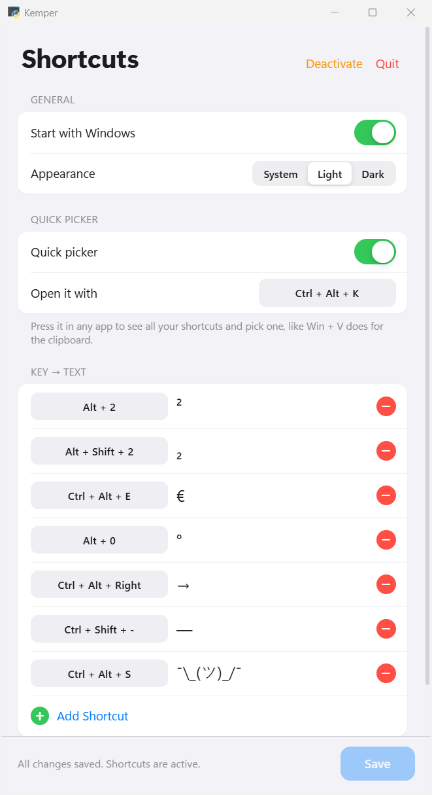
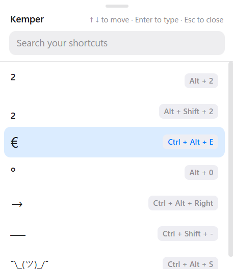
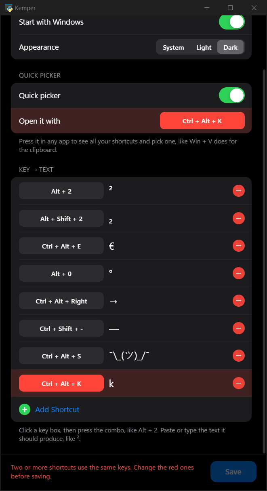
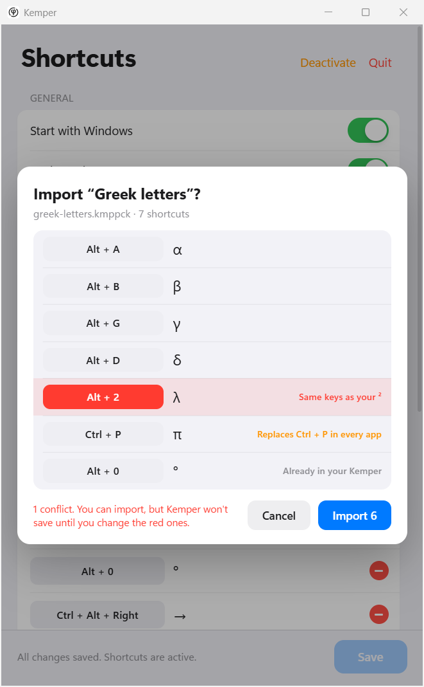

<p align="center"></p>

<h1 align="center">Kemper</h1>

<p align="center"><b>Any character. One key combo.</b><br>Press <b>Alt + 2</b>, get <b>²</b>. Press <b>Ctrl + Alt + E</b>, get <b>€</b>. In every app on Windows, macOS and Linux.</p>

<p align="center">
  <a href="https://github.com/Shashwat-Gupta57/Kemper/releases/latest/download/kemper.pyw"><b>Download</b></a> ·
  <a href="https://kemper.talken.in"><b>Website</b></a> ·
  <a href="marketplace"><b>Keypack Marketplace</b></a> ·
  <a href="docs/DOCUMENTATION.md"><b>Documentation</b></a>
</p>

<p align="center">
  <a href="https://github.com/Shashwat-Gupta57/Kemper/actions/workflows/tests.yml"></a>
  
  
  <a href="LICENSE"></a>
</p>

<p align="center">
  
  &nbsp;&nbsp;
  
</p>

**Kemper** (short for **Key Mapper**) types the character or text you choose whenever you press a key combo. Symbols, accents, emoji, other scripts, whole sentences: if you can paste it, Kemper can type it.

## Why Kemper

- **Works in every app.** Word, Chrome, Discord, VS Code, games, anything you can type into.
- **Set a combo like in a game.** Click the key box, press the keys, type what they should produce.
- **Quick picker.** Forgot a combo? **Ctrl + Alt + K** pops up all your shortcuts by the mouse. Search and press Enter.
- **Keypacks.** Share sets of shortcuts as `.kmppck` files, get ready-made ones from the [Marketplace](marketplace), or let an AI write one.
- **Can't get it wrong.** Two shortcuts on the same keys turn red, and Kemper won't save until you fix them.
- **One file.** The whole program is [`kemper.pyw`](kemper.pyw). No installer, nothing hidden.

## Install

Download [`kemper.pyw`](https://github.com/Shashwat-Gupta57/Kemper/releases/latest/download/kemper.pyw) and keep it in a folder where it can stay. You need [Python 3.10 or newer](https://www.python.org/downloads/).

<details open>
<summary><b>Windows 10 and 11</b></summary>

```powershell
python -m pip install pywebview
```

Then double-click `kemper.pyw`. From then on, Kemper is in the Start menu: type *Kemper* in Start to open it. Turn on **Start with Windows** and **Desktop shortcut** in the window if you want them. The desktop shortcut carries Kemper's icon.
</details>

<details>
<summary><b>macOS</b></summary>

```bash
python3 -m venv ~/.kemper
~/.kemper/bin/pip install pywebview pynput
~/.kemper/bin/python kemper.pyw
```

macOS asks to let Terminal (or Python) use **Input Monitoring** and **Accessibility**. Allow both in System Settings → Privacy & Security, then start Kemper again.
</details>

<details>
<summary><b>Ubuntu and other Linux</b></summary>

```bash
sudo apt install python3-venv python3-gi gir1.2-webkit2-4.1 xclip
python3 -m venv --system-site-packages ~/.kemper
~/.kemper/bin/pip install pywebview python-xlib
~/.kemper/bin/python kemper.pyw
```

Kemper needs an **X11 session**: on Ubuntu's login screen, click the gear and pick **Ubuntu on Xorg**. Wayland doesn't let any app have global hotkeys.
</details>

Something not working? `python kemper.pyw --doctor` checks your setup and says how to fix each problem.

## Use it

1. Click **Add Shortcut**. The key box turns blue.
2. Press your combo, for example **Alt + 2**.
3. Type or paste what it should produce, for example `²`.
4. Click **Save**.

Now Alt + 2 types ² in any app. Closing the window keeps your shortcuts working. **Deactivate** pauses them, and **Quit** stops Kemper.

| Recording a combo | Two shortcuts with the same keys |
|:---:|:---:|
|  |  |

## Keypack Marketplace

Ready-made keypacks you can import in two clicks. Every one of them works alongside the others.

| | | |
|---|---|---|
| [**Super & subscripts**](marketplace/superscripts-subscripts.kmppck)<br>x² H₂O CO₂ | [**Greek letters**](marketplace/greek.kmppck)<br>α β γ δ π σ Σ Ω | [**Math symbols**](marketplace/math.kmppck)<br>≠ ± × ÷ ≤ ≥ ∞ √ |
| [**Arrows**](marketplace/arrows.kmppck)<br>← → ↑ ↓ ⇒ | [**Currency symbols**](marketplace/currency.kmppck)<br>€ £ ¥ ₹ ₿ | [**Typography**](marketplace/typography.kmppck)<br>– — … “ ” © ™ |
| [**Everyday emoji**](marketplace/emoji.kmppck)<br>👍 ❤️ 😂 🙏 🎉 | [**Text faces**](marketplace/text-faces.kmppck)<br>¯\\\_(ツ)\_/¯ ಠ\_ಠ | **[Browse all →](marketplace)** |

Download one from the [Marketplace](marketplace) or [the website](https://kemper.talken.in/#marketplace) and double-click it. Kemper shows every shortcut in it, marks any that clash with yours, and imports only when you say so.

**Make your own** in Kemper's Keypack Editor (**Keypacks → Create a keypack**), or have ChatGPT, Claude or Gemini write one: copy the [AI instructions](docs/AI_INSTRUCTIONS.md), say what you want, and paste the answer into the editor. Made one worth sharing? [Add it to the Marketplace](marketplace#adding-your-keypack).

<p align="center"></p>

## Command line

Everything the window does also works from a terminal, and changes reach a running Kemper right away.

```console
> python kemper.pyw --add "Alt+2" "²"
Added Alt + 2  →  ²

> python kemper.pyw --keys
  Alt + 2          →  ²
  Alt + Shift + 2  →  ₂

2 shortcut(s), active. Quick picker: Ctrl + Alt + K
```

<details>
<summary><b>All commands</b></summary>

| Command | What it does |
|---|---|
| *(none)* | Open the window |
| `--cli` | Run in the terminal with no window. Ctrl+C stops it |
| `--keys` | List your shortcuts |
| `--add COMBO TEXT` | Add a shortcut |
| `--remove COMBO` | Remove a shortcut |
| `--picker COMBO` / `on` / `off` | Set the quick picker's combo, or turn it on or off |
| `--activate` / `--deactivate` | Turn all shortcuts on or off |
| `--autostart on` / `off` | Start Kemper when you sign in, or stop doing so |
| `--desktop on` / `off` | Add or remove the desktop shortcut with Kemper's icon |
| `--keypack FILE` | Open a keypack and ask whether to import it |
| `--ai-instructions` | Print the instructions that let an AI chat write keypacks |
| `--status` | Is Kemper running? Where are its files? |
| `--doctor` | Find problems and say how to fix them |
| `--show` / `--quit` | Open the window of the running Kemper, or stop it |
| `--uninstall` | Remove Kemper from this computer |
| `--help`, `--version` | Help, version |

Every command is explained in the [documentation](docs/DOCUMENTATION.md#command-line-reference).
</details>

## Known issues

- **Ctrl + Shift + 0 never fires on Windows.** Windows keeps that combo for switching to the Japanese keyboard, even when Japanese isn't installed, and swallows it before any app sees it. Kemper marks it in red. [How to free it](docs/DOCUMENTATION.md#ctrlshift0-or-another-combo-never-fires).
- **Linux needs X11.** Wayland doesn't let apps have global hotkeys.
- **AltGr is Ctrl + Alt.** On keyboards with an AltGr key, a Ctrl + Alt shortcut can take over a character you type with AltGr.

More in [Troubleshooting](docs/DOCUMENTATION.md#troubleshooting).

## Uninstall

```powershell
python kemper.pyw --uninstall
```

It asks first, then stops Kemper, removes it from startup, the desktop and the Start menu, unlinks `.kmppck` files, deletes your settings and deletes `kemper.pyw` itself. Nothing else on your computer changes.

## Contributing

Bug reports, ideas, keypacks and pull requests are welcome. See [CONTRIBUTING.md](CONTRIBUTING.md).

## License

[MIT](LICENSE) © 2026 Shashwat Gupta
